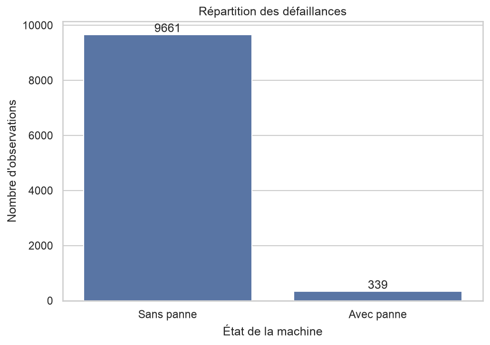
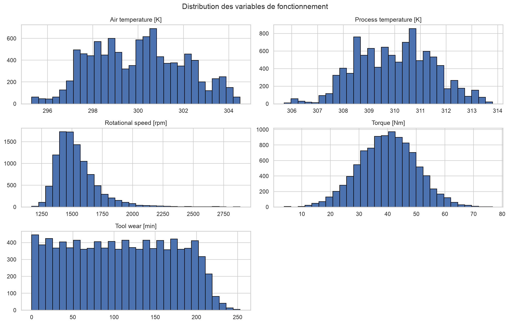
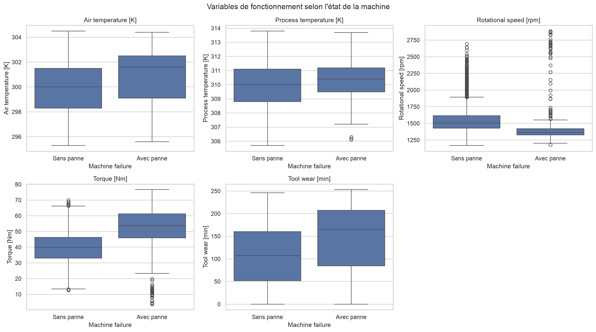
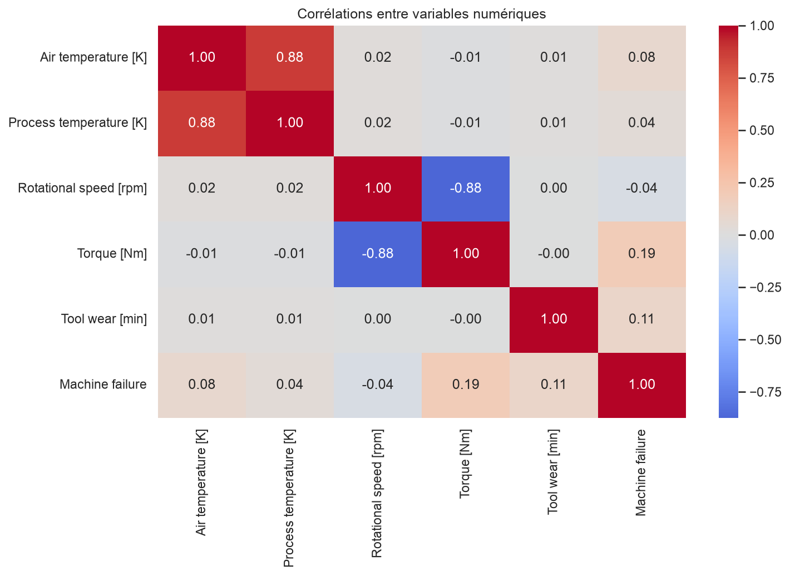

# Industrial Predictive Maintenance

**Machine Learning | Predictive Analytics | FastAPI | Docker**

A machine learning project designed to predict industrial machine failures using operational sensor measurements and provide real-time risk predictions through a REST API.

## 1. Project Overview

Unexpected machine failures can cause production interruptions, maintenance costs, and operational losses.

This project develops a predictive maintenance system that analyzes machine operating conditions to estimate the probability of failure and identify machines requiring inspection.

The solution combines data analysis, machine learning, threshold optimization, REST API development, and Docker deployment.

## 2. Business Problem

The objective is to predict whether an industrial machine is likely to experience a failure based on its operating measurements.

The project addresses three main challenges:

- Failure events are rare compared with normal operating conditions.
- Missing a real failure can be costly.
- A trained model must be accessible through a reproducible and usable interface.

**Main objective:** prioritize failure detection while controlling false alarms.

## 3. Dataset

The project uses the **AI4I 2020 Predictive Maintenance Dataset**.

- 10,000 observations
- 14 original columns
- 339 machine failures
- 9,661 observations without failure
- Failure rate: 3.39%

### Main features

| Feature | Description |
|---|---|
| Type | Machine quality variant |
| Air temperature [K] | Air temperature |
| Process temperature [K] | Process temperature |
| Rotational speed [rpm] | Rotational speed |
| Torque [Nm] | Machine torque |
| Tool wear [min] | Tool wear |

**Target variable:** `Machine failure`

Identifiers and failure-mode indicators were excluded from model inputs to prevent information leakage.

## 4. Project Architecture

```text
industrial-predictive-maintenance/
│
├── data/
│   └── raw/
│       └── ai4i2020.csv
│
├── notebooks/
│   └── 01_exploratory_data_analysis.ipynb
│
├── src/
│   ├── __init__.py
│   ├── inspect_data.py
│   ├── train_model.py
│   ├── optimize_threshold.py
│   └── api.py
│
├── models/
│   ├── predictive_maintenance_pipeline.joblib
│   └── decision_threshold.json
│
├── reports/
│   ├── figures/
│   │   ├── failure_distribution.png
│   │   ├── numerical_distributions.png
│   │   ├── features_by_failure.png
│   │   ├── correlation_matrix.png
│   │   └── precision_recall_threshold.png
│   ├── test_metrics.json
│   └── validation_model_comparison.csv
│
├── tests/
│   └── test_api.py
│
├── Dockerfile
├── docker-compose.yml
├── .dockerignore
├── requirements.txt
└── README.md
```

## 5. Exploratory Data Analysis

Exploratory Data Analysis was performed to understand the dataset, investigate feature distributions, and examine relationships between operating conditions and machine failures.

### Visualizations

**Failure Distribution**



**Numerical Feature Distributions**



**Features by Failure Status**



**Correlation Matrix**



## 6. Machine Learning Methodology

Three classification algorithms were evaluated:

- Logistic Regression
- Decision Tree
- Random Forest

### Preprocessing

- Median imputation for numerical features.
- Most-frequent imputation for categorical features.
- Standard scaling for numerical variables.
- One-hot encoding for categorical variables.

The dataset was divided into training, validation, and test sets using stratified splitting.

| Dataset | Percentage |
|---|---:|
| Training | 70% |
| Validation | 15% |
| Testing | 15% |

The validation set was used for model selection and threshold optimization. The test set was reserved for final evaluation.

### Model Comparison

Validation results:

| Model | Precision | Recall | F1-score | ROC-AUC |
|---|---:|---:|---:|---:|
| Random Forest | 0.7500 | 0.5294 | 0.6207 | 0.9772 |
| Decision Tree | 0.4400 | 0.6471 | 0.5238 | 0.8149 |
| Logistic Regression | 0.1365 | 0.7255 | 0.2298 | 0.8750 |

Random Forest was selected based on its validation F1-score.

## 7. Threshold Optimization

Because machine failures are rare, the default classification threshold of 0.5 may not provide sufficient failure detection.

The classification threshold was optimized using the **F2-score**, which gives greater importance to recall.

Selected threshold:

`0.2603`

Validation performance at the optimized threshold:

| Metric | Result |
|---|---:|
| Precision | 57.97% |
| Recall | 78.43% |
| F2-score | 73.26% |

## 8. Final Model Evaluation

The final model was evaluated on the independent test set using the optimized threshold.

| Metric | Test Result |
|---|---:|
| Accuracy | 96.47% |
| Precision | 48.81% |
| Recall | 80.39% |
| F1-score | 60.74% |
| F2-score | 71.18% |
| Average Precision | 75.31% |

### Confusion Matrix

| | Predicted: No Failure | Predicted: Failure |
|---|---:|---:|
| Actual: No Failure | 1,406 | 43 |
| Actual: Failure | 10 | 41 |

The model detected 41 out of 51 actual failures, corresponding to approximately 80.39% recall.

The trade-off is a higher number of false alarms. This is an important consideration when designing maintenance strategies.

## 9. REST API

A REST API was developed using **FastAPI** to expose the trained model.

### Available endpoints

| Method | Endpoint | Description |
|---|---|---|
| GET | `/health` | Check API and model status |
| POST | `/predict` | Predict machine failure risk |

Interactive API documentation is available at:

`http://localhost:8000/docs`

### Example prediction request

```json
{
  "Type": "L",
  "Air temperature [K]": 303.5,
  "Process temperature [K]": 315.0,
  "Rotational speed [rpm]": 1200,
  "Torque [Nm]": 65.0,
  "Tool wear [min]": 240
}
```

### Example response

```json
{
  "failure_probability": 0.742386,
  "threshold": 0.2603,
  "prediction": 1,
  "risk": "High risk",
  "message": "Potential machine failure detected. Inspection recommended."
}
```

## 10. Docker Deployment

The API is containerized using Docker and Docker Compose.

### Build and start

```bash
docker compose up --build -d
```

### Check running containers

```bash
docker compose ps
```

### View logs

```bash
docker compose logs -f
```

### Stop the application

```bash
docker compose down
```

Once started, access the API at:

`http://localhost:8000`

## 11. Automated Testing

The API is tested using Pytest and FastAPI TestClient.

The following scenarios are covered:

- API health check.
- Low-risk machine prediction.
- High-risk machine prediction.

Run the tests:

```bash
python -m pytest -v
```

**Test results:** 3 tests passed.

## 12. Technologies Used

- **Programming:** Python
- **Data Processing:** Pandas, NumPy
- **Machine Learning:** Scikit-learn
- **Visualization:** Matplotlib, Seaborn
- **Model Persistence:** Joblib
- **API Development:** FastAPI, Uvicorn
- **Testing:** Pytest
- **Containerization:** Docker, Docker Compose
- **Development Environment:** Jupyter Notebook, VS Code

## 13. Limitations and Future Improvements

Potential future improvements include:

- Testing additional classification algorithms.
- Improving precision while maintaining high recall.
- Evaluating model performance on additional industrial datasets.
- Adding model monitoring and data drift detection.
- Integrating real-time sensor data streams.
- Developing a maintenance dashboard.
- Deploying the API to a cloud environment.

The current model is a prototype for decision support, not a replacement for professional maintenance inspections.

## 14. Author

JADE-DINE ALABI 

**Big Data Analytics Engineering Student**

Interested in Data Science, Machine Learning, Data Engineering, and predictive analytics.

